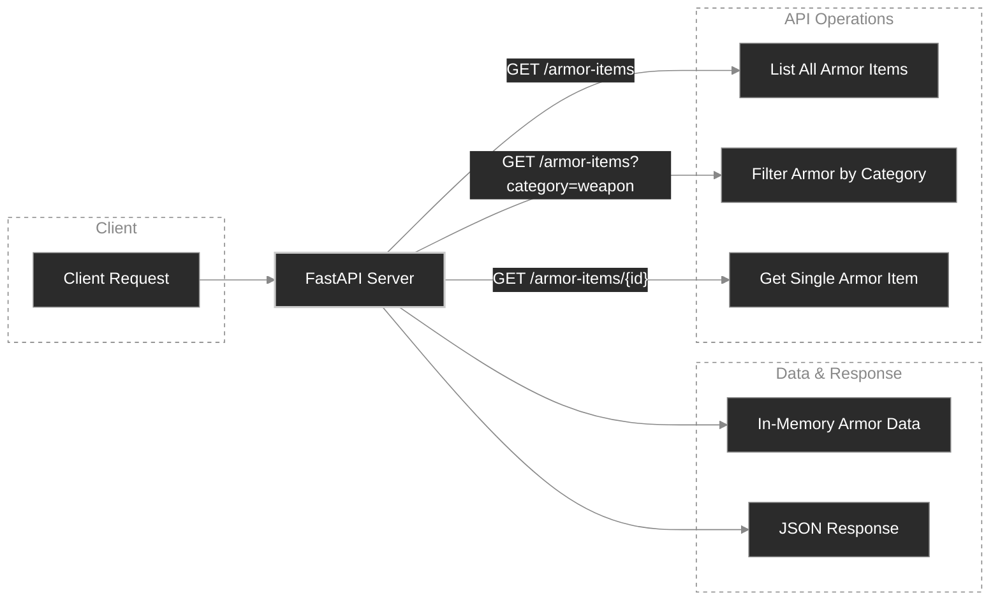

## Arcade Armor
When players enter the lobby inside a retro RPG arcade zone, available weapons, potions, and armor must render instantly. Arcade Armor requires an ultra-fast, read-only menu & inventory API so game can fetch the latest gear listings. 

## Core Deliverables:
 - Zero-Latency In-Memory Reads: Store and serve catalog items directly from memory.
 - Full Inventory Retrieval: Return structured lists of all available equipment.
 - Dynamic Category Filtering: Query items by class (e.g., armor, weapon, potion, accessory).
 - Single-Item Lookup: Fetch item stats and availability by unique item ID with proper 404 Not Found handling.
 - Strict Response Validation: Enforce consistent JSON response formats using Pydantic schemas.

## Architecture
